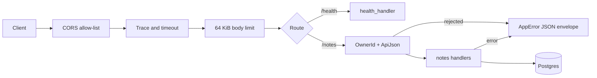

# Architecture

`template-rust` is one Rust crate: a library (`src/lib.rs`) that builds an Axum
router over a Postgres pool, and a thin binary (`src/main.rs`) that loads
configuration, runs migrations, binds a port and serves until `SIGINT` or `SIGTERM`.
Integration tests call the router directly, so the binary holds no logic worth testing.

## Request flow

## Code map

Find the existing helper here before you write a new one.

| Path | Responsibility | Reuse, don't recreate |
| --- | --- | --- |
| `src/main.rs` | Bootstrap, logging, migrations, graceful shutdown | Add startup steps here, not in handlers |
| `src/state.rs` | `AppState`: shared config and database pool | Take `State<AppState>`; do not create pools elsewhere |
| `src/core/config.rs` | `AppConfig`, the only reader of environment variables | Add a field and a `from_lookup` line; never call `std::env::var` elsewhere |
| `src/core/error.rs` | `AppError` and its JSON envelope | Return `AppError`; `From<sqlx::Error>` makes `?` work on queries |
| `src/core/jwt.rs` | `JwtValidator`: product JWT checks against the product JWKS | Take the validator from `AppState`; never validate tokens anywhere else |
| `src/api/mod.rs` | Router, body limit, timeout, CORS allow-list | Register routes and layers here |
| `src/api/extract.rs` | `OwnerId` (fail-closed identity) and `ApiJson` (envelope-shaped body errors) | Use `OwnerId` for the caller and `ApiJson` for bodies |
| `src/api/health.rs` | Health endpoint | Copy its shape for unauthenticated probes |
| `src/api/notes.rs` | Example slice: handlers, validation, SQL | Reuse `note_columns!`, `note_not_found` and the `validate_*` functions |
| `src/api/openapi.rs` | `ApiDoc`: the OpenAPI document assembled from handler annotations | List new paths and schemas here |
| `src/bin/gen_openapi.rs` | Prints the OpenAPI document for `make openapi` | A generator, not part of the service |
| `openapi/openapi.json` | The committed API contract | Never edit by hand; run `make openapi` |
| `clients/ts/` | The generated TypeScript client | Never edit by hand; run `make openapi` |
| `migrations/` | Versioned SQL, embedded at compile time | Add a new numbered file; never edit an applied one |
| `tests/` | Integration tests at the router | Build the app with `app_router`; copy `tests/security_test.rs` for tests that need no database |

## Invariants

- No `std::env::var` outside `src/core/config.rs` [enforced by ast-grep].
- No `unwrap()` or `expect()` in production code [enforced by clippy].
- Every directory is listed in `scripts/repo-policy.json` [enforced by `make policy`].
- Documented paths, make targets and environment variables exist [enforced by `make policy`].
- No caller identity means `401`; the header counts only with `TRUST_IDENTITY_HEADER=true` [enforced by `tests/security_test.rs`].
- Only tokens signed by a product JWKS key validate, with expiry, issuer and audience enforced [enforced by `tests/jwt_test.rs`].
- The dev identity flag can never be `true` in production [enforced by the `AppConfig` unit tests].
- CORS allows only configured origins [enforced by `tests/security_test.rs`].
- Every error response uses the same JSON envelope [enforced by `tests/security_test.rs`].
- Every query on `notes` filters by `owner_id` [enforced by `tests/notes_test.rs`].
- The committed spec and client match the generated output, and every route is annotated [enforced by `make openapi-check` and `tests/openapi_test.rs`].
- `AppError::Internal` never reaches a client [review-only].
- Licenses, sources and bans in the dependency tree [enforced by cargo-deny].

## Service ladder

Baseline §1 decides each production concern once per product. The template
takes the free, portable default where it can and leaves the rest to the
derived product.

| Concern | Template choice |
| --- | --- |
| Database | Plain Postgres. `compose.yaml` runs it locally; the service only needs `DATABASE_URL`. |
| Auth | Product JWTs validated against `PRODUCT_JWKS_URL`, plus the dev header for local work. |
| Email, SMS, payments, AI, files, analytics, errors, uptime | Out of template scope. Derived products follow the baseline service ladder. |

## Cross-cutting concerns

| Concern | How it works |
| --- | --- |
| Configuration | `AppConfig::from_env` reads the process environment once at startup. `from_lookup` takes any key lookup, so tests need no environment. |
| Errors | Handlers return `Result<_, AppError>`. The envelope is `{"error": {"message": "...", "status": 404}}`. Internal causes are logged, never returned. |
| Auth | `OwnerId` is the only way a handler learns the caller. A bearer token is validated against the product JWKS (`sub` becomes the caller); otherwise the `x-user-id` header counts only with `TRUST_IDENTITY_HEADER=true`. The header is a stub marked `TEMPLATE-TODO(auth)`. |
| Logging | `tracing` with an `EnvFilter` from `LOG_LEVEL`. `TraceLayer` logs each request. |
| Database | One `sqlx::PgPool` in `AppState`. Queries use `query_as` with `FromRow`. |
| Migrations | `sqlx::migrate!("./migrations")` runs at startup. |
